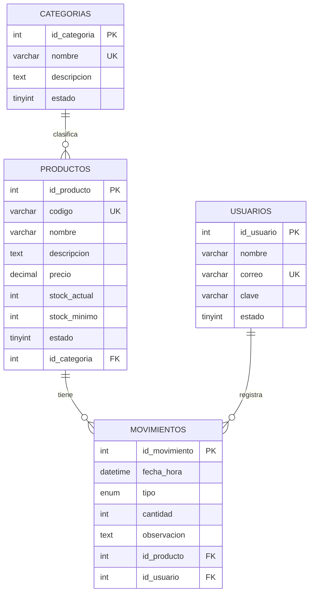

# Análisis y requerimientos

## Problema

TecnoStock registra sus productos en una planilla. Esto genera códigos duplicados, errores en las cantidades y poca claridad sobre el stock real. Se necesita una aplicación web sencilla, que funcione en un servidor local y que mantenga la integridad de los datos.

## Actor

**Encargado de inventario**: inicia sesión, administra productos y categorías, y registra las entradas y salidas de existencias. Es el único rol del sistema.

## Alcance

Incluye: inicio de sesión, productos (registrar, listar, buscar, editar, desactivar), categorías, movimientos de inventario con historial y alertas de stock bajo.

No incluye: roles múltiples, ventas o facturación, reportes exportables, ni administración de usuarios desde la web (los usuarios se crean directamente en la base de datos).

## Requerimientos funcionales

| N.º | Requerimiento | Implementación | Pruebas |
|---|---|---|---|
| RF1 | Iniciar sesión con un usuario registrado | `login.php`, `logout.php`, `includes/sesion.php` | 1 a 5 |
| RF2 | Registrar productos (código, nombre, categoría, descripción, precio, stock actual y mínimo) | `producto_nuevo.php`, `includes/form_producto.php`, `includes/validar_producto.php` | 6 a 9 |
| RF3 | Consultar el listado de productos | `productos.php` | 10 |
| RF4 | Buscar por nombre, código o categoría | `productos.php` | 10 a 12 |
| RF5 | Modificar precio, descripción, categoría y cantidades | `producto_editar.php` | 13 |
| RF6 | Desactivar productos que ya no se comercializan | `producto_estado.php`, `productos.php` | 14, 15 |
| RF7 | Registrar entradas y salidas de existencias | `movimientos.php` | 16 a 19, 21 |
| RF8 | Alertar cuando el stock actual es menor que el mínimo | `dashboard.php`, `productos.php`, `movimientos.php` | 20 |

Además se implementó la gestión de categorías (`categorias.php`), porque el caso asigna al encargado la administración de categorías y los productos dependen de ellas.

## Reglas de negocio

| N.º | Regla | Dónde se cumple |
|---|---|---|
| RN1 | El código de producto no se repite | `UNIQUE` en MySQL, consulta previa en `validar_producto.php` y captura del error 1062 |
| RN2 | Precio, stocks y cantidad de movimiento no son negativos; la cantidad es mayor que cero | `CHECK` en MySQL, validación PHP y atributos `min` en el formulario |
| RN3 | Todo movimiento registra fecha, tipo, cantidad, producto y usuario | `INSERT` en `movimientos.php`; la fecha la asigna MySQL |
| RN4 | Una salida no puede dejar el stock bajo cero | Comprobación dentro de la transacción en `movimientos.php` y aviso en `validaciones.js` |
| RN5 | Un producto con movimientos se desactiva, no se elimina | No existe borrado en la aplicación; `ON DELETE RESTRICT` en las claves foráneas |
| RN6 | El stock se actualiza solo tras cada movimiento válido | `UPDATE` y `INSERT` en una misma transacción |

## Modelo de datos

### Normalización

- **Primera forma normal:** todos los atributos son atómicos, no hay grupos repetidos y cada tabla tiene clave primaria.
- **Segunda forma normal:** todas las claves primarias son simples (un solo campo), por lo que no hay dependencias parciales.
- **Tercera forma normal:** los datos de la categoría viven en su propia tabla y no se repiten en cada producto; el usuario también tiene su tabla, y `movimientos` solo guarda claves foráneas hacia producto y usuario.

Una excepción deliberada: `stock_actual` se puede calcular a partir de los movimientos, pero se guarda en `productos` para consultar y alertar sin recalcular. Se mantiene consistente porque se actualiza en la misma transacción que inserta el movimiento.

### Integridad en la base de datos

Claves primarias y foráneas con `ON DELETE RESTRICT`, `UNIQUE` en código, correo y nombre de categoría, `CHECK` para valores no negativos y cantidad positiva, y `ENUM` para el tipo de movimiento.

## Decisiones de diseño

- **Transacción en PHP.** El movimiento usa `SELECT ... FOR UPDATE` dentro de una transacción PDO, lo que bloquea el producto y evita que dos salidas simultáneas lo dejen en negativo. El procedimiento `registrar_movimiento` del script SQL es una alternativa equivalente; la aplicación no depende de él.
- **El código no se edita.** Identifica al producto y es la clave de negocio.
- **Editar permite corregir cantidades**, como pide el caso. Esos cambios no quedan en el historial; la vía normal para variar el stock son los movimientos.
- **Validación doble.** JavaScript avisa antes de enviar y PHP vuelve a validar todo.
- **Seguridad.** Consultas preparadas con PDO, contraseñas con `password_hash` y `password_verify`, escape de salida con `htmlspecialchars`, token CSRF en formularios que modifican datos y acciones peligrosas solo por POST.
